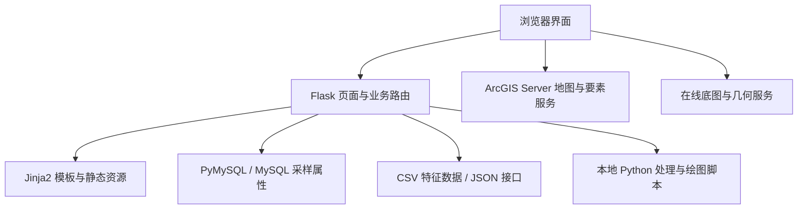
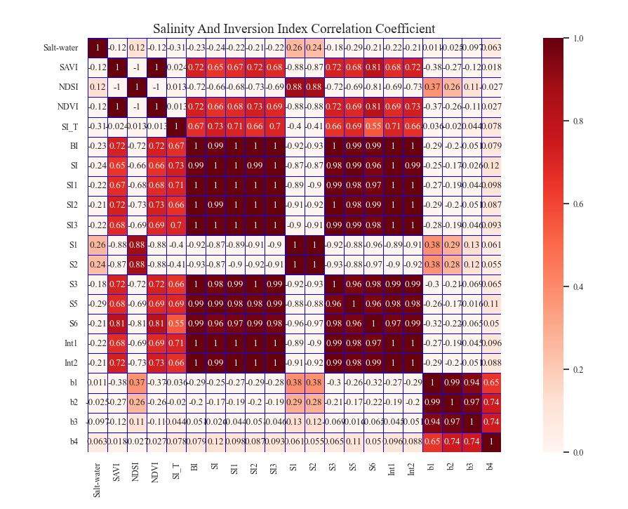

# 基于 GF-1 数据的库尔勒市表层土壤盐度遥感监测系统

本科毕业设计项目，围绕 GF-1 多光谱影像与地面土壤采样数据，结合 Python 分析、MySQL 数据管理和 WebGIS 地图展示，构建表层土壤盐度监测平台原型。

本仓库保存历史源码、分析样本和部分可视化成果，供项目展示与技术交流。原 MySQL 数据库、ArcGIS Server 服务和完整影像数据未随仓库提供，当前版本尚未恢复完整运行环境。

## 项目内容

| 模块 | 内容 |
| --- | --- |
| 首页大屏 | 采样信息展示、ECharts 图表、研究区地图与功能导航 |
| 采样数据管理 | 通过 Flask、PyMySQL 和 MySQL 查询、添加、编辑、删除采样属性 |
| 数据接口 | 读取 CSV 并返回 JSON，前端通过 Fetch 动态生成特征表格 |
| 影像处理 | 辐射定标与大气校正演示、光谱指数栅格计算、栅格转矢量实验 |
| 建模分析 | PLS 回归实验、相关性分析及历史分析图表 |
| WebGIS | 研究区与采样点展示、属性弹窗、成果图层切换、地图导航和绘制 |
| 几何测量 | 调用几何服务计算用户绘制多边形的面积与周长 |

研究分析包含离线处理和 GIS 服务发布步骤。部分页面使用预先计算的图片或固定数据展示，不代表每次点击都会重新执行模型计算。

## 技术组成

- 前端：HTML、CSS、JavaScript、jQuery、ECharts。
- Web 后端：Flask、Jinja2。
- 数据库访问：PyMySQL、MySQL。
- 地图展示：ArcGIS JavaScript API 3.43、ArcGIS Server REST 服务。
- 数据与模型：pandas、NumPy、scikit-learn。
- 遥感与绘图：GDAL、Rasterio、GeoPandas、OpenCV、Matplotlib、Seaborn。

主程序使用 PyMySQL 和手写 SQL；SQLAlchemy 相关导入保留在独立实验文件中。

## 系统结构



MySQL、CSV 和 ArcGIS 图层分别提供数据，当前源码没有实现三者自动同步。数据库表单主要采用服务端渲染；CSV 表格、文件接收及脚本触发使用局部异步请求。

## 目录说明

```text
.
├── text.py                  主程序，默认端口 5000
├── templates/               登录、首页、数据管理和分析页面
├── static/                  JavaScript、CSS、字体和成果图片
├── app.py                   NDVI、S1、S5、SAVI 指数栅格计算
├── GF1.py                   定标与校正演示
├── Cut.py                   影像预览与 PNG 输出，含历史注释方案
├── tif-shp.py               栅格多边形化实验
├── shp.py                   本机图像结果窗口
├── PLSR_CSV.py              单变量 PLS 回归实验
├── method_plsr.py           训练/测试划分与参数搜索实验
├── PLSR.py                  波段与盐分关系绘图
├── RMSE.py                  历史误差计算实验
├── chart.py                 相关矩阵热力图
├── tubiao*.py               历史固定数据图表
├── 热力图.csv               保存的分析样本：19 行、21 列
├── Kerle11.png / output.png 小体积图像文件
├── main.py                  MySQL 连接与查询实验
├── web.py                   独立 CRUD 实验服务
├── userdata.py              独立数据库 JSON 接口实验
├── csv_web.py               独立 CSV 接口实验
├── Docu.py                  本机文件选择实验
├── requirements.txt         根据源码整理的 Python 依赖
└── .gitignore               本地环境、数据和配置的排除规则
```

`app.py` 不是 Flask 主入口。`web.py` 和 `userdata.py` 是独立实验，默认同占端口 8888，不应与主程序一起作为一组服务全部启动。

## 部分历史成果

以下为项目保存的静态相关性分析图片，用于展示分析界面中的成果资源。



图中相关矩阵与模型测试精度含义不同；历史图表不作为当前模型泛化能力的证明。

## 环境恢复与启动

以下步骤用于后续恢复环境，不代表已经完成完整部署验证。安装依赖只能解决 Python 库的一部分问题，缺失的数据、服务和已知代码问题仍需要处理。

### 1. 准备 Python 与 GIS 依赖

`requirements.txt` 按当前源码的第三方导入整理，未锁定全部版本，不是原环境的完整导出，也不是已经验证的环境锁文件。

在准备好的 Python 环境中安装：

```bash
python -m pip install -r requirements.txt
```

GDAL 的 Python 绑定供 `app.py` 和 `tif-shp.py` 使用，需要与本机 GDAL 二进制环境匹配，因此没有直接放入上述 pip 安装列表。Windows 下可按照 [GDAL 官方安装说明](https://gdal.org/en/stable/download.html#conda)，在 Conda 环境中安装，并在同一环境中安装其他依赖：

```bash
conda install -c conda-forge gdal rasterio geopandas
```

涉及 Matplotlib、Tkinter 的脚本会打开后端所在机器的桌面窗口。Tkinter 随 Python 发行环境提供，不通过 requirements.txt 安装。

### 2. 恢复数据库与输入数据

- 自行准备 MySQL 数据库 `flask` 和采样表 `si`。仓库未提供原始数据库备份及建表 SQL。
- 按源码字段整理表结构：`Id`、`采样地`、`有机质`、`全氮`、`总磷`、`含水率`、`全钾量`、`水溶性盐_1`、`X`、`Y`。实际类型与约束需重新定义。
- 将 `text.py` 中数据库连接配置替换为本机配置。独立实验文件 `main.py`、`web.py`、`userdata.py` 如需使用，也要单独配置。
- `YOUR_MYSQL_PASSWORD` 是占位值，不能直接连接数据库。真实凭据应保存在本地配置或环境变量中，避免提交到公开仓库。
- 影像脚本需要自行提供有效的 `Kerle11.tif` 等输入。部分实验仍包含旧电脑的绝对路径，运行前需调整。

### 3. 恢复地图服务

地图脚本中的服务地址指向 `localhost:6080`，需要重新发布相应 ArcGIS 服务并修改地址，涉及 `static/js/map.js`、`map1.js` 和 `map5.js`。

浏览器中的 localhost 指浏览器所在电脑。部署给其他电脑访问时，应使用可访问的服务地址。在线底图、外部前端资源和几何服务也需要网络访问。

### 4. 启动主程序

在包含 `text.py` 的仓库根目录执行：

```bash
python text.py
```

默认访问 [本地主页](http://127.0.0.1:5000/index) 或 [CSV 表格页面](http://127.0.0.1:5000/index02)。当前代码开启 Flask debug 模式，适用于本地调试，公开部署前需要调整。

GitHub 仓库用于保存和展示源码；GitHub Pages 不能直接运行本项目的 Flask、MySQL 和 ArcGIS 后端。

## 当前版本的已知限制

- 登录页是界面原型，没有完整的后端身份验证和权限控制。
- 上传路由接收文件后尚未保存，也未把上传路径绑定到后续处理任务。
- 脚本触发路由缺少有效返回值，前端 JSON 处理与后端结果回传尚未接通；后端使用同步子进程调用，没有任务队列。
- 数据编辑表单提交 `Id`，后端格式化 SQL 时使用 `id`，当前版本存在键名不一致问题；数据库操作也需要改为参数化查询并补充校验。
- 首页部分数据、建模数值和图表为固定展示内容，修改 MySQL 数据不会自动更新全部页面和地图。
- 历史模型实验存在训练集内评价、R² 乘以 10、目标列混入输入和 RMSE 定义错误。页面中的 `0.9459` 等展示值不应作为有效模型精度引用，需纠正后重新实验。
- SAVI 计算脚本的因子位置与页面公式不一致；影像 NoData 和空间元数据处理也需要完善。
- 当前测量功能计算绘制区域的面积和周长，没有实现按盐渍化等级统计面积；未保留完整的模型逐像元预测和自动服务发布链路。

这些限制保留为后续恢复和改进的依据，仓库按历史毕设原型展示。

## 第三方组件

项目使用现有前端组件和部分模板代码。jQuery、ECharts、ArcGIS API、图标字体等第三方资源的权利归各自权利人所有，使用时应遵守对应许可，并保留原有声明。仓库中的第三方资源不作为全部自主开发的内容介绍。
